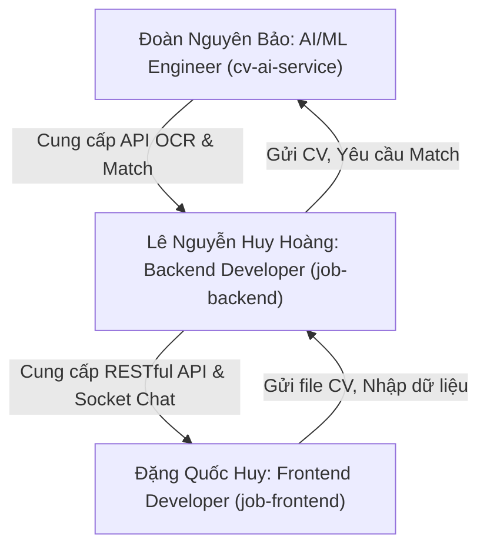

# KẾ HOẠCH PHÂN CHIA NHIỆM VỤ & PHỐI HỢP PHÁT TRÌỂN HỆ THỐNG
## 👥 Đội Ngũ: Đặng Quốc Huy | Lê Nguyễn Huy Hoàng | Đoàn Nguyên Bảo

Để hệ thống **Phân tích CV và Gợi ý việc làm bằng AI** hoạt động trơn tru, mượt mà và đồng bộ nhất, 3 bạn cần phân chia vai trò rõ ràng, làm chủ repository của mình, và tuân thủ một lộ trình khớp nối (integration) nghiêm ngặt. 

Dưới đây là bảng phân chia nhiệm vụ chi tiết và kế hoạch phối hợp từng bước dành cho nhóm của bạn.

---

## 🛠️ PHẦN 1: PHÂN CHIA VAI TRÒ & NHIỆM VỤ CHI TIẾT

### 👤 1. Bạn Đoàn Nguyên Bảo: AI/ML Engineer (Quản lý `cv-ai-service`)
**Trọng tâm công việc**: Trích xuất chính xác thông tin từ CV và đảm bảo mô hình gợi ý việc làm đạt độ chính xác cao nhất.

*   **Nhiệm vụ thiết lập ban đầu (Chạy thử nghiệm)**:
    1.  Cài đặt thành công môi trường ảo Python và cài đặt toàn bộ `requirements.txt`.
    2.  Tải mô hình tiếng Anh `spacy` và kiểm tra xem `underthesea` có tự động tải mô hình tiếng Việt khi chạy hay không.
    3.  Cài đặt công cụ đọc ảnh **Tesseract OCR** trên máy cá nhân và cập nhật đường dẫn chính xác vào `.env` (`TESSERACT_CMD`).
    4.  Mở tài liệu Swagger (`http://localhost:8000/docs`) để test thử API `POST /api/v1/extract` bằng cách đăng tải thử một vài file CV thực tế dạng PDF và ảnh.
*   **Nhiệm vụ tích hợp & phát triển nâng cao**:
    1.  **Chuẩn hóa cấu trúc JSON trả về**: Đảm bảo định dạng dữ liệu đầu ra của API `extract` (danh sách kỹ năng, số năm kinh nghiệm, học vấn) khớp chính xác với định dạng mà Hoàng cần lưu trữ trong MongoDB.
    2.  **Tối ưu hóa tốc độ xử lý OCR**: Xử lý bất đồng bộ hoặc giảm dung lượng ảnh trước khi đọc để tăng tốc phân tích.
    3.  **Hỗ trợ đồng đội**: Cung cấp cấu trúc file dữ liệu mẫu CSV để Hoàng biết cách gọi API huấn luyện lại mô hình (`/api/v1/train`).

---

### 👤 2. Bạn Lê Nguyễn Huy Hoàng: Backend Developer (Quản lý `job-backend`)
**Trọng tâm công việc**: Làm cầu nối trung gian, quản lý Cơ sở dữ liệu MongoDB, xử lý logic nghiệp vụ đăng tuyển, ứng tuyển, và thiết lập kênh nhắn tin thời gian thực.

*   **Nhiệm vụ thiết lập ban đầu (Chạy thử nghiệm)**:
    1.  Cài đặt thư viện Node.js và khởi động cơ sở dữ liệu MongoDB cục bộ (hoặc tạo một cluster MongoDB Atlas miễn phí để cả nhóm dùng chung).
    2.  Tạo tài khoản **Cloudinary** (miễn phí) để lấy các khóa bí mật (`CLOUDINARY_CLOUD_NAME`, `API_KEY`, `API_SECRET`) phục vụ lưu trữ file CV của ứng viên trực tuyến.
    3.  Tạo mật khẩu ứng dụng Gmail (App Password) để cấu hình **Nodemailer** gửi email thông báo tự động.
    4.  Khởi chạy server Express ở cổng `3001` và kiểm tra phản hồi từ API sức khỏe: `GET /health`.
*   **Nhiệm vụ tích hợp & phát triển nâng cao**:
    1.  **Kết nối đến AI Service**: Viết hàm gọi API sang `cv-ai-service` (cổng `8000`) sử dụng Axios mỗi khi ứng viên tải CV lên, nhận dữ liệu trích xuất từ Bảo và lưu vào MongoDB.
    2.  **Quản lý kênh WebSocket Chat**: Đảm bảo sự kiện kết nối Socket.IO hoạt động ổn định, phân luồng tin nhắn chính xác theo `roomId` của cuộc trò chuyện giữa Ứng viên và Nhà tuyển dụng.
    3.  **Cung cấp tài liệu API**: Gửi danh sách các route, định dạng dữ liệu truyền đi/nhận về (Request/Response) và JWT Token cho Huy.

---

### 👤 3. Bạn Đặng Quốc Huy: Frontend Developer (Quản lý `job-frontend`)
**Trọng tâm công việc**: Xây dựng giao diện Next.js 14 tuyệt đẹp, mượt mà, trực quan và tối ưu hóa trải nghiệm kéo thả nộp đơn của người dùng.

*   **Nhiệm vụ thiết lập ban đầu (Chạy thử nghiệm)**:
    1.  Cài đặt toàn bộ thư viện Node.js (`npm install`).
    2.  Cấu hình `.env.local` trỏ chính xác đến cổng Backend API (`http://localhost:3001`) và cổng AI Service (`http://localhost:8000`).
    3.  Khởi chạy giao diện ở chế độ phát triển (`npm run dev`) và kiểm tra xem có lỗi TypeScript hay lỗi biên dịch Tailwind nào không.
*   **Nhiệm vụ tích hợp & phát triển nâng cao**:
    1.  **Xử lý biểu mẫu & Xác thực**: Tích hợp React Hook Form & Zod để kiểm tra thông tin nhập vào từ biểu mẫu đăng ký, đăng nhập của người dùng.
    2.  **Kéo thả tải lên CV**: Xây dựng UI kéo thả CV trực quan bằng `react-dropzone`, hiển thị thanh tiến trình (Progress Bar) tải lên sinh động.
    3.  **Tích hợp React Query**: Sử dụng React Query để tự động gọi API lấy danh sách việc làm, thông tin cá nhân và tự động lưu cache để giảm thời gian tải trang.
    4.  **Kết nối Chat thời gian thực**: Sử dụng `socket.io-client` để kết nối đến cổng Backend của Hoàng, lắng nghe và cập nhật tin nhắn ngay lập tức lên màn hình khi có cuộc trò chuyện.

---

## 📈 PHẦN 2: LỘ TRÌNH 4 BƯỚC KHỚP NỐI TOÀN DIỆN (INTEGRATION ROADMAP)

Để tránh tình trạng "máy mình chạy được nhưng ghép lại thì lỗi", nhóm cần tuân thủ nghiêm ngặt quy trình khớp nối sau:

### 📍 BƯỚC 1: Kiểm thử độc lập (Từng bạn chạy riêng)
*   **Bảo**: Chạy `cv-ai-service` -> Truy cập `/docs` -> Tải file CV trực tiếp trên web Swagger -> Nhận kết quả JSON thành công.
*   **Hoàng**: Chạy MongoDB -> Chạy `job-backend` -> Dùng Postman tạo tài khoản mới -> Nhận JWT Token thành công.
*   **Huy**: Chạy `job-frontend` -> Mở giao diện đăng nhập -> Hiển thị đầy đủ form và không bị lỗi biên dịch.

### 📍 BƯỚC 2: Khớp nối AI Service & Backend API (Bảo & Hoàng)
*   **Mục tiêu**: Khi gọi API của Backend, Backend gọi tiếp sang AI Service và nhận kết quả phân tích CV.
*   **Thao tác**:
    1.  Bảo chạy AI Service tại cổng `8000`.
    2.  Hoàng cấu hình `AI_SERVICE_URL=http://localhost:8000` trong file `.env` của Backend.
    3.  Hoàng dùng Postman gửi một file CV lên endpoint `/api/cv/upload` của Backend.
    4.  **Kết quả mong đợi**: Console của AI Service nhận tín hiệu trích xuất chữ -> Trả JSON về cho Backend -> Backend lưu thông tin phân tích vào MongoDB và trả về mã thành công `200 OK`.

### 📍 BƯỚC 3: Khớp nối Backend API & Frontend (Hoàng & Huy)
*   **Mục tiêu**: Người dùng thao tác trên màn hình Next.js, dữ liệu được gửi về MongoDB lưu trữ và hiển thị ra màn hình.
*   **Thao tác**:
    1.  Hoàng chạy Backend tại cổng `3001`.
    2.  Huy cấu hình `NEXT_PUBLIC_API_URL=http://localhost:3001` trong file `.env.local` của Frontend.
    3.  Huy thực hiện thao tác Đăng nhập trên giao diện Next.js.
    4.  **Kết quả mong đợi**: Form đăng nhập gửi request sang Backend -> Backend xác thực chính xác mật khẩu băm bằg bcrypt -> Trả về JWT Token -> Frontend lưu Token vào Zustand Store và chuyển hướng người dùng sang trang Bảng điều khiển (`/dashboard`).

### 📍 BƯỚC 4: Kiểm thử kịch bản chạy thử toàn hệ thống (Cả 3 Bạn)
Cả nhóm cùng ngồi lại và thực hiện một quy trình hoàn chỉnh (End-to-End):
1.  **Nhà tuyển dụng**: Đăng ký -> Đăng tin tuyển dụng "Senior React Developer" kèm danh sách kỹ năng yêu cầu.
2.  **Ứng viên**: Đăng ký -> Tải file CV lên hệ thống -> AI phân tích kỹ năng -> Gợi ý công việc "Senior React Developer" vừa đăng tuyển -> Ứng viên bấm "Ứng tuyển".
3.  **Tương tác**: Nhà tuyển dụng nhận được đơn ứng tuyển -> Mở kênh Chat hỏi han ứng viên -> Hai bên nhắn tin thời gian thực mượt mà.

---

## ⚠️ PHẦN 3: CÁC "CẠM BẪY" LỒI THƯỜNG GẶP & CÁCH GIẢI QUYẾT

### 🚨 1. Lỗi CORS (Cross-Origin Resource Sharing)
*   **Hiện tượng**: Huy (Frontend) gọi API sang Hoàng (Backend) thì bị trình duyệt chặn và báo lỗi màu đỏ đầy màn hình console (`Access-Control-Allow-Origin`).
*   **Nguyên nhân**: Frontend chạy ở cổng `3000` khác cổng `3001` của Backend nên trình duyệt chặn để bảo mật.
*   **Giải pháp**: Hoàng kiểm tra cấu hình trong file `job-backend/src/server.js` hoặc file `.env`: Đảm bảo giá trị `FRONTEND_URL` được cấu hình chính xác là `http://localhost:3000` và middleware `cors` đã bật tính năng `credentials: true`.

### 🚨 2. Lỗi Không Tìm Thấy File Tesseract OCR trên Windows
*   **Hiện tượng**: Khi ứng viên tải ảnh hoặc PDF dạng scan lên, AI Service báo lỗi crash hệ thống không tìm thấy file thực thi.
*   **Nguyên nhân**: Hệ thống chưa được cài đặt phần mềm Tesseract OCR độc lập hoặc biến môi trường `TESSERACT_CMD` trỏ sai đường dẫn.
*   **Giải pháp**: Bảo cài đặt phần mềm Tesseract OCR lên máy của mình, lấy đường dẫn file chạy thực tế (Ví dụ trên Windows: `C:\Program Files\Tesseract-OCR\tesseract.exe`) dán chính xác vào file `.env` của AI Service.

### 🚨 3. Lỗi Lệch Định Dạng Dữ Liệu So Khớp (Data Schema Mismatch)
*   **Hiện tượng**: AI Service phân tích kỹ năng trả về danh sách dạng mảng chuỗi (`['Python', 'React']`) nhưng Backend Express lại mong muốn nhận dạng chuỗi phân cách bởi dấu phẩy (`"Python, React"`) dẫn đến lỗi cơ sở dữ liệu.
*   **Giải pháp**: Bảo và Hoàng cần ngồi lại để thống nhất chính xác định dạng JSON đầu ra của API `/api/v1/extract` trước khi viết code xử lý lưu trữ database.

---

## 💡 LỜI KHUYÊN ĐỂ LÀM VIỆC NHÓM ĐẠT HIỆU QUẢ CAO NHẤT

1.  **Dùng chung 1 MongoDB Atlas**: Thay vì mỗi bạn cài đặt MongoDB cục bộ dẫn đến dữ liệu không đồng bộ, hãy nhờ **Hoàng** tạo một MongoDB Atlas đám mây miễn phí và chia sẻ chuỗi kết nối (`MONGODB_URI`) cho cả nhóm. Khi đó, cả nhóm sẽ làm việc trên cùng một tập dữ liệu thực tế.
2.  **Giao tiếp qua Discord/Zalo**: Khi Hoàng thay đổi API hoặc Bảo thay đổi định dạng JSON, phải cập nhật ngay lập tức cho các thành viên khác để sửa code đồng bộ.
3.  **Tận dụng file `README_GLOBAL.md`**: Tôi đã tạo sẵn file này trong thư mục của cả 3 bạn để bất kỳ lúc nào các bạn quên cách khởi động hoặc cổng chạy của dịch vụ khác, các bạn đều có thể mở ra đọc ngay tại chỗ.
